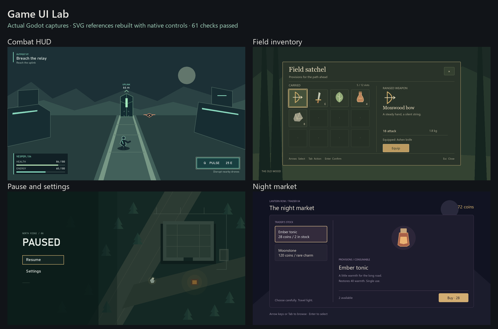
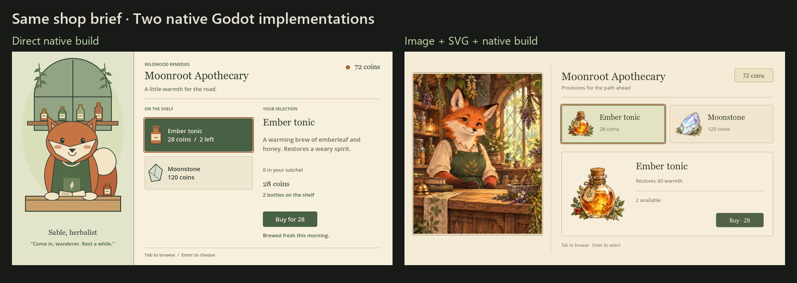

# Game UI examples

These examples exercise the `game-ui-design` workflow in Godot 4.7.1. Sources, targets, actual viewport captures, and machine-readable results are included.

## SVG lab



Open [svg-lab/project.godot](svg-lab/project.godot) in Godot and run it. F1 selects the HUD, F2 inventory, F3 pause/settings, and F4 the shop. Each screen has an editable SVG target, an inspected preview, native Controls, interaction checks, and design notes.

The shared runner passed 61 checks. It exercises resource spending, inventory state, pause and resume, settings, focus return, purchases, stock and affordability. It also captures 1280x720 and 1024x768 views. Read [the results](svg-lab/evidence/test-results.json) and [screen notes](svg-lab/notes/).

## Image and hybrid shop



The [shared brief](hybrid-shop/brief.md) defines one woodland RPG shop. The direct builder used the written brief without visual references. The hybrid route generated a concept and three separate illustration assets, refined an SVG layout, then implemented native UI. Both builders could inspect their running screens and correct defects.

Each branch passed the same 14 native-input checks. The original concept, prompts, artwork, editable SVG, source, captures and [evaluation limits](hybrid-shop/evaluation.md) are included. Open [hybrid-shop/report.html](hybrid-shop/report.html) locally to switch viewport sizes and purchase states. GitHub displays HTML source rather than running that report.

The first hybrid engine capture had downscaling artifacts. Mipmapped sampling made the artwork smoother. Keyboard testing also found a focus trap when Buy became disabled. These findings informed later skill revisions. The resulting SVG and native UI still simplify the original concept's painted frames and ornament.

## Run the published checks

The PowerShell launchers require Windows and a Godot executable on PATH. From the repository root:

```powershell
.\examples\game-ui-design\svg-lab\run-tests.ps1 -Godot Godot
.\examples\game-ui-design\hybrid-shop\direct\run-tests.ps1 -Godot Godot
.\examples\game-ui-design\hybrid-shop\hybrid\run-tests.ps1 -Godot Godot
```

Pass your executable's path instead of `Godot` when needed. Each launcher uses a bounded graphics process, captures the real viewport and exits. The hybrid launcher imports source PNGs before running. A real graphics session is required for screenshots; Godot's headless dummy renderer cannot substitute for these captures.

The examples were verified on Windows with the OpenGL compatibility renderer at 1280x720 and 1024x768. They request installed fonts such as Georgia, Segoe UI, Bahnschrift and Consolas. Other systems can use fallbacks with different text metrics. No fonts are bundled.

## What the evidence supports

These are small working demonstrations. They establish the recorded layouts and interactions on the tested setup. They do not prove a general aesthetic or speed advantage. Agent prompts, effort and timing were not equalized in the direct/hybrid comparison. Physical controllers, touch hardware, exports, localization, other operating systems and moving production gameplay were not checked.

Historical supplemental results and some state captures are retained as development evidence. The reproducible public suites are the `run-tests.ps1` launchers above. Diagnostic logs and regenerable Godot caches are excluded from Git. A sandbox shader-cache warning occurred during local tests without preventing captures or input checks.
